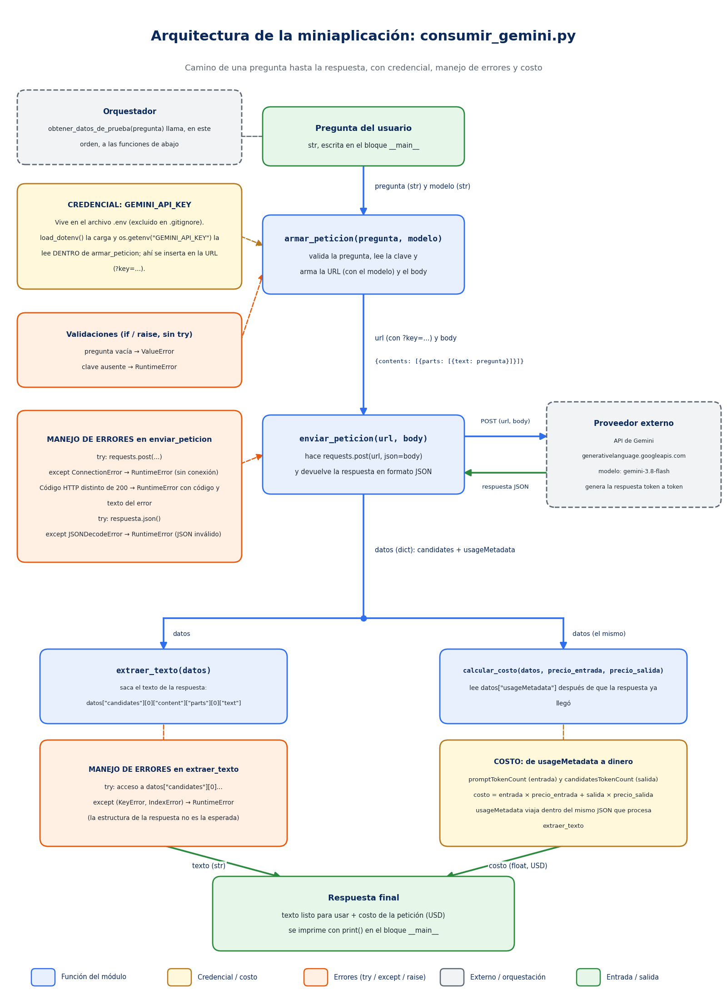

# Decisión de arquitectura: elección de modelo

## Modelo elegido

**gemini-3.8-flash** (API de Gemini, Google). Es el modelo por defecto de la miniaplicación (`MODELO_POR_DEFECTO` en `src/consumir_gemini.py`).

## Diagrama de arquitectura

El flujo parte con la pregunta del usuario. `armar_peticion(pregunta, modelo)` valida la entrada, lee `GEMINI_API_KEY` desde el archivo `.env` y arma la URL (con el modelo elegido) y el cuerpo de la petición. `enviar_peticion` hace el POST a la API, con `try/except` para los errores de conexión y de JSON, y lanza `RuntimeError` si el código HTTP no es 200. `extraer_texto` saca el texto de la respuesta (con `try/except` para `KeyError` e `IndexError`) y `calcular_costo` calcula el costo a partir de `usageMetadata`, que viaja en la misma respuesta.

## Comparación de candidatos

Mediciones hechas con la misma miniaplicación, la misma pregunta de prueba y 4 repeticiones por modelo (cronometradas con `time.perf_counter()` alrededor de `enviar_peticion`), repetidas en dos corridas.

| Criterio | gemini-3.5-flash-lite | gemini-3.8-flash |
|---|---|---|
| Costo por 1000 tokens de entrada | 0,0003 USD | 0,00075 USD (tarifa vigente a oct-2026) |
| Costo por 1000 tokens de salida | 0,0025 USD | 0,00375 USD (tarifa vigente a oct-2026) |
| Latencia promedio observada | 2,0 s (1,95 s y 2,12 s en dos corridas) | 7,7 s (7,38 s y 7,99 s en dos corridas) |
| Costo de una petición (pregunta 1) | 0,000172 USD | 0,000258 USD con la tarifa vigente (0,000516 USD con la tarifa desde 2027) |
| Calidad de respuesta para mi caso concreto | Buena: cálculos correctos, pero respuestas más generales y con imprecisiones en normativa | Muy buena: respuestas mucho más técnicas y completas en las 3 preguntas |
| Fecha de medición | 2026-10-22 | 2026-10-22 |

Preguntas de prueba (de mi caso: normativa de arquitectura y construcción):
1. Explica en 3 líneas qué es el coeficiente de constructibilidad.
2. ¿Qué documentos mínimos pide una DOM para un permiso de edificación de una vivienda unifamiliar?
3. Un terreno de 300 m2 tiene ocupación de suelo de 0,6. ¿Cuántos m2 puedo ocupar en el primer piso?

Resultados de calidad:
- Pregunta 1: ambos correctos en lo esencial. gemini-3.8-flash agregó un ejemplo numérico; gemini-3.5-flash-lite habló de "densidad poblacional", que es otro parámetro urbanístico.
- Pregunta 2: gemini-3.8-flash entregó una respuesta más técnica y ordenada. Los dos modelos citaron artículos distintos de la OGUC (5.1.4 y 5.1.6), así que esa cita debe verificarse contra la norma.
- Pregunta 3: ambos acertaron (180 m2).

Nota sobre precios: según fuentes secundarias, la tarifa de gemini-3.8-flash (0,75 USD de entrada y 3,75 USD de salida por millón de tokens) rige hasta el 31 de diciembre de 2026 y se duplica el 1 de enero de 2027. Confirmar siempre en https://ai.google.dev/gemini-api/docs/pricing.

## Justificación

Para esta miniaplicación, un asistente sobre normativa de arquitectura y construcción, el criterio que más pesó fue la calidad técnica de la respuesta. En las tres preguntas de prueba, gemini-3.8-flash dio respuestas notablemente más técnicas y completas, sobre todo en la pregunta de los documentos mínimos de la DOM, donde el detalle es justamente lo que importa.

La mayor latencia (unos 7,7 segundos frente a 2) es aceptable porque el producto entrega un resultado, no una conversación en vivo. El costo por petición es mayor, pero sigue siendo de fracciones de centavo; igualmente hay que vigilarlo, porque el uso gratuito del pre-chequeo no debe generar gastos descontrolados.

Una limitación: que una respuesta sea más técnica no garantiza que sea correcta. Como ambos modelos citaron artículos distintos de la OGUC para lo mismo, la aplicación no debe depender de lo que el modelo recuerda, sino verificar contra la norma.

## Alternativa descartada y por qué

**gemini-3.5-flash-lite.** Es unas 4 veces más rápido y cerca de 1,5 veces más barato por petición, pero sus respuestas fueron más generales y con imprecisiones en normativa. Como la precisión técnica es el requisito principal de esta miniaplicación, el ahorro en tiempo y costo no lo compensa. Se reconsiderará para tareas más simples (por ejemplo, clasificar o extraer datos) donde la velocidad y el costo pesen más que el detalle.

## Revisión futura

- Volver a medir cuando cambie la tarifa de gemini-3.8-flash (1 de enero de 2027).
- Repetir la comparación si Google publica nuevos modelos de la serie 3.x.
